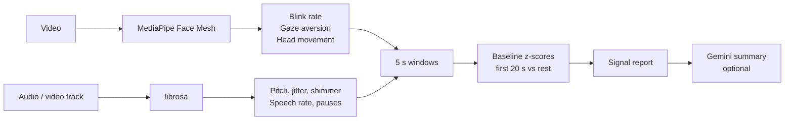

[](https://github.com/shraddhauser/multimodal-lie-detector/actions/workflows/ci.yml)  

A research prototype that measures how a speaker's **blink rate, gaze, head movement and voice** change relative to **their own baseline** in a recording. It was built by team Cloud Sprint for **GDG TechSprint (3rd Prize)** and has since been rebuilt so that every number it shows is actually computed. It produces a signal-consistency report, **not a lie/truth verdict**. Headline result: on synthetic audio, the pipeline recovers a 220 Hz → 330 Hz pitch shift after the baseline period (source: `tests/unit/test_pipeline.py`, run with `pytest`). It has not been evaluated on real recordings.

> [!IMPORTANT]
> **Ethics & limitations, please read.**
> - Scientific consensus is that **no reliable physiological or behavioral "lie signature" exists**. A change in these signals can come from stress, cognitive load, fatigue or simply the situation.
> - **Do not use this tool for hiring, policing, legal proceedings or any other high-stakes decision.**
> - Signals vary with **culture, neurodivergence, anxiety, disability and recording conditions** (lighting, camera angle, microphone).
> - **Only analyse recordings made with the speaker's consent.** Uploaded media is deleted right after analysis, and unanalysed uploads after 30 minutes. Reports stay in your browser tab; nothing is stored server-side by default.

## Demo

TODO(Shraddha): record `docs/images/demo.gif` (10–20 s, upload → results page) and add screenshots as `docs/images/screenshot-*.png`. There is no hosted demo.

## The problem

Behavioral-analysis demos often present a single "deception score" as if it were a measurement. Signals such as blink rate or vocal pitch differ hugely between people, so comparing someone against a population average mostly measures who they are. This project asks a narrower, answerable question instead: *how much did this person's signals change compared with the start of the same recording?* It reports each signal separately, so a reader can see exactly what moved and by how much.

## What I built / my role

TODO(Shraddha): describe what you built during the hackathon and what the team built; see [CONTRIBUTORS.md](CONTRIBUTORS.md).

The post-hackathon revamp in this repository replaced the placeholder modules with a real pipeline. It also added baseline z-score fusion, fixed the upload security and privacy issues, and added the test suite, CI and docs.

## Architecture



1. Each video frame gives 478 face landmarks (MediaPipe Face Mesh, with iris points).
2. Landmarks become blink rate (eye aspect ratio), gaze-aversion ratio (iris position between the eye corners) and head-movement variance (nose tip).
3. The audio (a separate file, or the video's own track) becomes pitch, jitter, shimmer, speech rate and pause ratio.
4. Everything is cut into 5-second windows. Windows in the first 20 s form the speaker's baseline.
5. Each signal becomes a z-score against the baseline's mean and spread. The deviation index is their weighted mean absolute value.
6. Optionally, Gemini writes a plain-English summary that always carries the ethics caveat.

More detail: [docs/ARCHITECTURE.md](docs/ARCHITECTURE.md).

## Tech stack

| Layer | Technology | Why chosen |
|---|---|---|
| Face landmarks | MediaPipe Face Mesh 0.10.21 | 478 landmarks including iris, CPU-only, pip install |
| Face boxes | OpenCV Haar cascade | Already in the original code; no model download |
| Audio features | librosa (pyin) | Standard, well-documented pitch and energy features |
| Fusion | NumPy | Per-speaker z-scores need nothing heavier |
| AI summary | Google Gemini (optional) | Turns numbers into prose; mocked in tests |
| Speech-to-text | openai-whisper (optional) | Offline transcription; not installed by default |
| Web | Flask + Chart.js | Small server-rendered app; one chart on the results page |
| Quality | pytest, ruff, pre-commit, GitHub Actions | Offline test suite and lint on every push |

## Key features

- Blink rate, gaze-aversion ratio and head-movement variance from face landmarks
- Pitch mean and variability, jitter, shimmer, speech rate and pause ratio from audio
- Per-speaker baseline z-scores with a labelled fallback to relative change
- A results page with a per-signal chart and table, analysis details and JSON download
- Uploads deleted after analysis; only server-issued upload IDs accepted
- Optional Gemini summary and Whisper transcript
- Live webcam analysis (planned)
- Per-window timeline chart (planned)

## Results

| Metric | Value | Source / command |
|---|---|---|
| Test suite | 58 passed | `pytest` |
| Line coverage (`src/`, `web/`) | 85 % | `pytest --cov=src --cov=web --cov-report=term` |
| Signal accuracy on real recordings | TODO(measure) | Not measured. Needs a consented, annotated sample set; no script in this repo produces it yet |
| Processing time per minute of video | TODO(measure) | `python src/main.py <video.mp4>` timed on a 60 s clip |

Limitations: the 20-second baseline gives only 4 windows, so standard deviations are rough. A stressful opening distorts the baseline. Blink and gaze need a frontal, well-lit face. The micro-expression and speech-emotion modules are simulated placeholders and are not used in the report.

## Quick start

Requires Python 3.11. ffmpeg is optional and is needed to read audio from a video file.

Windows (PowerShell):

```powershell
python -m venv .venv
.venv\Scripts\Activate.ps1
pip install -r requirements.txt
copy .env.example .env      # optional: GEMINI_API_KEY, SECRET_KEY
python web\app.py           # http://localhost:5000
```

Linux / macOS:

```bash
python3.11 -m venv .venv
source .venv/bin/activate
pip install -r requirements.txt
cp .env.example .env        # optional: GEMINI_API_KEY, SECRET_KEY
python web/app.py           # http://localhost:5000
```

From the command line: `python src/main.py path/to/video.mp4 [path/to/audio.wav]` prints the JSON report.

`make install | make test | make run | make lint` do the same on systems with `make`.

## Running tests

```bash
pip install -r requirements-dev.txt
pytest
```

Expected output is `58 passed` in well under 2 minutes, with no internet, GPU or API keys needed. Fixtures are synthetic: sine and silent WAVs, and a generated video of a drawn cartoon face. The suite covers audio features, blink counting and EAR, fusion maths, the Gemini fallback, the end-to-end pipeline, and the web API's status codes, path-traversal and privacy behaviour. See [docs/TESTING.md](docs/TESTING.md).

## Project structure

```text
├── src/
│   ├── main.py                 # pipeline: windows, baseline, report
│   ├── face_analysis/          # Face Mesh landmarks, EAR; micro_expression (simulated)
│   ├── eye_tracking/           # blinks, gaze aversion, head movement
│   ├── audio_analysis/         # librosa features; Whisper (optional); emotion (simulated)
│   ├── fusion/                 # baseline z-score fusion
│   └── gemini/                 # optional summary + caveat
├── web/                        # Flask app, templates, static JS/CSS
├── tests/
│   ├── conftest.py             # synthetic fixtures
│   ├── unit/
│   └── integration/            # Flask test client
├── docs/                       # architecture, decisions, API, testing, troubleshooting
└── .github/                    # CI, issue and PR templates
```

## Engineering decisions and trade-offs

- **Per-speaker baseline, not population thresholds.** This measures change within one person rather than differences between people ([ADR-001](docs/DECISIONS.md#adr-001-compare-each-speaker-to-their-own-baseline-not-to-population-thresholds)).
- **MediaPipe pinned to 0.10.21.** It gives iris landmarks on CPU, at the cost of a `numpy<2` pin ([ADR-002](docs/DECISIONS.md#adr-002-mediapipe-face-mesh-for-landmarks-haar-cascade-kept-only-for-face-boxes)).
- **No supervised "deception classifier".** There is no valid labelled data, and the ethical risk is high ([ADR-003](docs/DECISIONS.md#adr-003-no-supervised-deception-classifier)).
- **Windowed baseline for real z-scores.** The 5 s windows give the baseline a spread, and a labelled fallback is used when it has none ([ADR-004](docs/DECISIONS.md#adr-004-windowed-baseline-for-real-z-scores-with-a-labelled-fallback)).
- **Upload IDs, not paths.** This removes path traversal and arbitrary file reads by design ([ADR-005](docs/DECISIONS.md#adr-005-the-analyze-endpoint-accepts-server-issued-upload-ids-never-file-paths)).

## Limitations and future work

- Not validated on real recordings; signal accuracy is unmeasured (see Results).
- Speech rate is approximated by onsets per second, not syllables, and shimmer is an RMS-energy approximation.
- The baseline and segment are fixed (first 20 s vs the rest); there is no per-question segmentation yet.
- Upload IDs live in memory, so the app runs as a single process only.
- `google-generativeai` is deprecated upstream; migrating to `google-genai` is planned.
- Planned: per-window timeline on the results page, webcam input, and per-question segments.

## Credits, licence, contact

- Team Cloud Sprint: Shraddha Pardeshi (team lead), Syed Fatema Zohra, Zaid Ali Syyed. See [CONTRIBUTORS.md](CONTRIBUTORS.md).
- 3rd Prize, GDG TechSprint. TODO(Shraddha): add the certificate as `docs/images/award.png`.
- [MIT License](LICENSE). Changes are listed in [CHANGELOG.md](CHANGELOG.md), and troubleshooting tips are in [docs/TROUBLESHOOTING.md](docs/TROUBLESHOOTING.md).
- Questions: open a GitHub issue.
