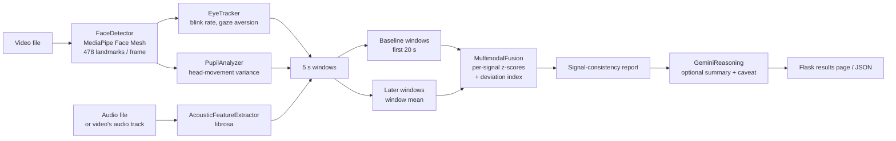
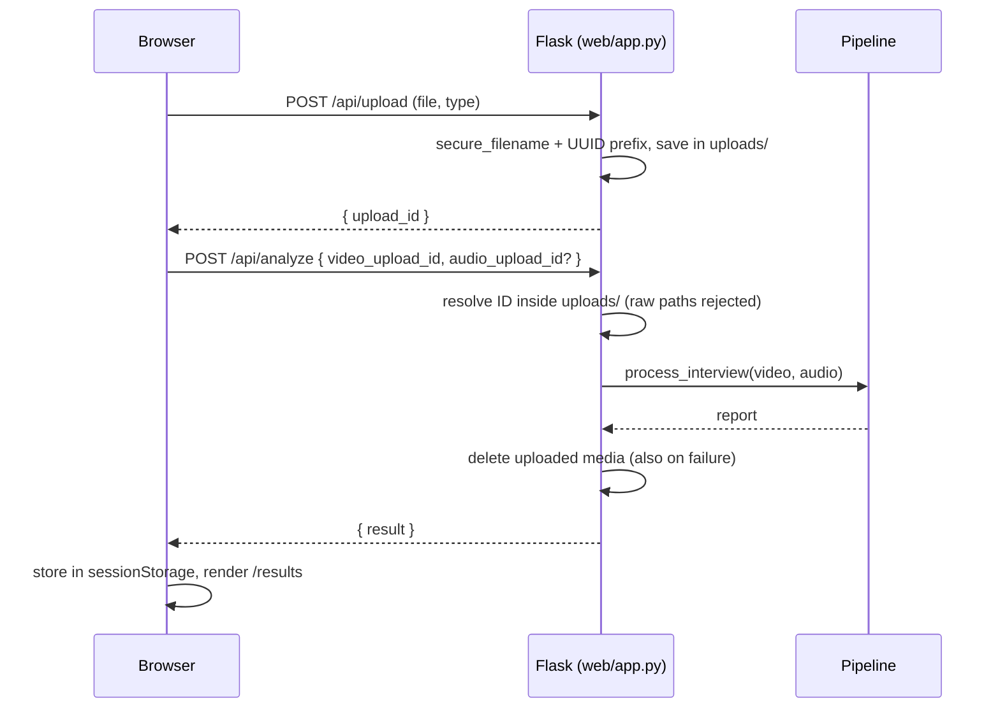

# Architecture

## Walkthrough

1. **Landmarks.** `FaceDetector.get_landmarks()` runs MediaPipe Face Mesh (`refine_landmarks=True`, so iris points are included) on every frame. Frames with no face give `None`. If the installed MediaPipe has no legacy `solutions` API, landmarks are unavailable and only audio signals are produced. The Haar cascade is still used for `detect_faces()`.
2. **Face signals.** `EyeTracker` turns landmarks into blink rate (eye aspect ratio below 0.21 for at least 2 frames counts as a blink) and the gaze-aversion ratio (the share of frames where the iris sits more than 0.15 from the centre of the eye, measured between the eye corners). `PupilAnalyzer` gives the variance of the nose-tip position.
3. **Audio signals.** `AcousticFeatureExtractor` loads mono 16 kHz audio and computes pitch mean and std (pyin), jitter, shimmer, speech rate (onsets per second) and pause ratio (frames more than 40 dB below the peak).
4. **Windows and baseline.** `LieDetectionPipeline.process_video()` cuts both streams into 5 s windows. Windows in the first 20 s make up the speaker's baseline, kept as one value per window. The later windows are averaged into one value per signal.
5. **Fusion.** `MultimodalFusion.compute_deviation()` computes `(segment − baseline mean) / baseline std` for each signal. If the baseline has fewer than 2 windows, or no spread, it falls back to relative change and labels that in `methods`. The deviation index is the weighted mean of absolute deviations, with weights renormalised over the signals that are actually available.
6. **Report.** `GeminiReasoning.generate_report()` wraps the deviation report, the analysis metadata and a fixed ethics caveat. If `GEMINI_API_KEY` is set it adds a plain-English summary; without a key, or on any API error, `ai_summary` is `None`.

## Web request flow

## Modules

| Module | Status |
|---|---|
| `face_analysis/face_detector.py` | Real: MediaPipe Face Mesh landmarks, EAR, Haar face boxes |
| `eye_tracking/eye_tracker.py` | Real: blink counting, gaze-aversion ratio |
| `eye_tracking/pupil_analysis.py` | Real: head-movement variance (pupil dilation is not measured, see DECISIONS) |
| `audio_analysis/acoustic_features.py` | Real: librosa features |
| `audio_analysis/speech_to_text.py` | Real but optional: needs `openai-whisper` |
| `fusion/multimodal_fusion.py` | Real: baseline z-scores |
| `gemini/gemini_reasoning.py` | Real but optional: needs `GEMINI_API_KEY`; mocked in tests |
| `face_analysis/micro_expression.py` | **Simulated / rule-based**: landmark-displacement events; not used in the report |
| `audio_analysis/emotion_analysis.py` | **Simulated placeholder**: returns uniform scores; not used in the report |
